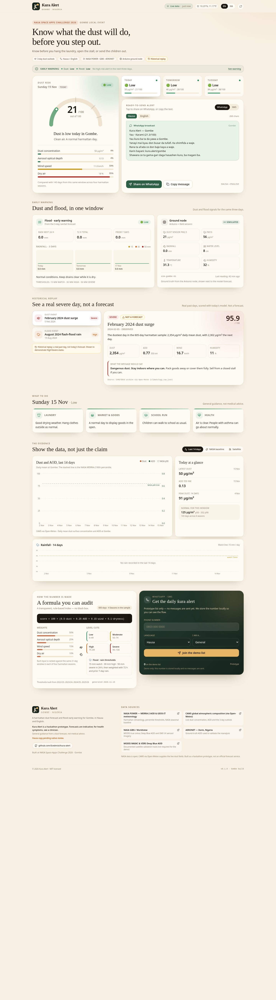

<div align="center">


# Ƙura Alert

**Know what the dust will do, before you step out.**

A bilingual harmattan dust forecast and flood early warning for **Gombe,
Nigeria** — built with NASA Earth observation data, with an Arduino ground node
that measures what the models cannot see.

[](LICENSE)


[Quickstart](#quickstart) · [Method](#how-the-forecast-works) · [Arduino node](#arduino-ground-node) · [API](#api) · [Docs](#documentation) · [Logo ideas](docs/logo-ideas.md)

</div>



---

## What it does

| | |
| --- | --- |
| **3-day dust risk** | Low / Moderate / High / Severe, with the four inputs and percentiles behind the number |
| **Flood early warning** | 24 h, 72 h and prior-7-day rainfall with hard 15/30/50 mm floors |
| **Hausa + English** | UI, advice cards and share messages in both languages |
| **WhatsApp / SMS** | A ready-to-send message, generated for the selected day |
| **Advice, not adjectives** | Laundry, market goods, school run and health — one concrete action each |
| **NASA evidence** | Live CAMS series, MERRA-2 seasonal baseline, GIBS satellite imagery, AERONET validation |
| **Ground node** | Arduino dust/rain/water-level station with a backlit LCD and local buzzer |
| **Works offline** | Cached and bundled snapshots; the page still loads if the API or uplink dies |
| **Historical replay** | Real severe-dust and flood days, clearly labelled, so a calm demo still shows High/Severe |

**Dust is the headline.** Flood early warning and the Arduino node are
extensions built because the same three-day window decides both.

Built for the **NASA Space Apps Challenge 2026**, Gombe local event (14–15
November 2026). It is a prototype, not an official forecast service.

---

## Quickstart

**Requirements:** Python 3.11+, Node.js 20+, npm. GNU Make is optional but
convenient. No API keys, no paid services.

```bash
git clone https://github.com/Icedmist/kura-alert.git
cd kura-alert

make install     # venv + pip + npm
make api         # terminal 1 → http://127.0.0.1:8000
make web         # terminal 2 → http://127.0.0.1:3000
```

Open **http://127.0.0.1:3000**. API docs are at
**http://127.0.0.1:8000/docs**.

Without Make:

```bash
# backend
cd services/api
python3 -m venv .venv
.venv/bin/pip install -r requirements.txt
.venv/bin/uvicorn app.main:app --reload --port 8000

# frontend, in a second terminal
cd apps/web
npm install
npm run dev
```

The first forecast request needs internet. After that, responses are cached for
30 minutes; if the network is unavailable, the dashboard falls back to the
snapshot in `apps/web/lib/fallback/` and labels it clearly.

### Optional configuration

Copy [`.env.example`](.env.example) to `.env` for the API. For the frontend,
put `KURA_API_URL` in `apps/web/.env.local` when the API is not on
`127.0.0.1:8000`.

| Variable | Default | Purpose |
| --- | --- | --- |
| `KURA_API_URL` | `http://127.0.0.1:8000` | API base used by Next.js |
| `KURA_CACHE_TTL` | `1800` | Seconds a live forecast stays cached |
| `KURA_INGEST_KEY` | unset (local only) | Shared key for the Arduino node; unset allows local requests only |
| `KURA_DATA_DIR` | `./data` | Thresholds, cache and SQLite location |

---

## How the forecast works

The dust index is deliberately rule-based. Every number on the page can be
recomputed from the JSON.

```
score = 100 × (0.50·dust + 0.25·AOD + 0.15·wind + 0.10·dryness)
```

- Each input is converted to an **empirical percentile against the same ±21-day
  window in four harmattan seasons** (2022/23–2025/26, **605 days**). November
  is compared with November, not with February.
- **Levels:** Low 0–49, Moderate 50–74, High 75–89, Severe 90–100.
- **Guardrails:** a clean-air cap (dust below the 15th/30th percentile cannot
  be called a dust event) and a rain-washout reduction.
- **Flood:** `0.55·rain24 + 0.30·rain72 + 0.15·rain7` with hard floors at
  15 mm (watch), 30 mm (high) and 50 mm (severe).

Worked example for 15 Nov 2026: `0.042 dust, 0.035 AOD, 0.587 wind, 0.951
dryness → 21.3/100 → Low`. The full derivation is in
[`docs/methodology.md`](docs/methodology.md).

### Data, and the honest lag

| Source | Used for | Freshness at build |
| --- | --- | --- |
| **CAMS** via Open-Meteo | Live dust, AOD, PM, 3-day outlook | Hourly model fields |
| **ERA5** via Open-Meteo | Wind, humidity, temperature, rainfall | Hourly |
| **NASA POWER / MERRA-2** | 605-day climatology, seasonal baseline, cross-check | **77-day lag** (latest 2026-08-30) |
| **NASA GIBS / Worldview** | True colour, AOD, UV aerosol imagery | 1–2 days |
| **AERONET Ilorin** | Ground-truth validation of MERRA-2 | r = **0.865**, n = 30, bias +0.163 AOD |

### Where is NASA in the live number?

**NASA is the baseline and the proof, not the live feed.** The live dust field
is CAMS because NASA's near-real-time aerosol products need Earthdata and lag by
weeks; calling a 77-day-old value "today" would be dishonest. NASA MERRA-2
defines what a normal and a dusty harmattan day look like across 605 days,
NASA GIBS shows the plume, and AERONET checks the reanalysis. The dashboard
**shows the lag instead of hiding it**. Full table and caveats:
[`docs/datasets.md`](docs/datasets.md).

### Hindcast and weight sensitivity

A calm November demo should not hide the model's behaviour. These checks are in
[`docs/hindcast.md`](docs/hindcast.md); the JSON is at
[`data/hindcast.json`](data/hindcast.json).

| Check | Result |
| --- | --- |
| The five dustiest real days (2,354 → 1,902 µg/m³) | **5/5 High or Severe** (4 Severe) |
| The five cleanest real days (0 → 33 µg/m³) | **5/5 Low** |
| Cleanest decile across held-out seasons | **65/65 Low or Moderate** |
| Dustiest decile across held-out seasons | 24/65 High or Severe — modest recall, stated honestly |
| Weights changed by ±10 % | **0/605 level changes** |
| Equal weights instead of the fitted weights | 18.5 % of days change level, mostly at boundaries |

This is a **historical replay of the index on observed days, not a forecast
skill score** — no archived forecast fields were available. The AERONET
r = 0.865 validates MERRA-2 against a sun photometer; it does **not** validate
the live CAMS forecast.

### Replay a real event

The dashboard has a **Historical replay** section with two real days:

- **5 Feb 2024** — the dustiest day in the 605-day sample (95.9/100, Severe).
- **19 Aug 2024** — 38.7 mm in 24 h, a real flash-flood rainfall day (High).

They are scored with the current model, labelled **Not a forecast**, and never
mixed into `/api/v1/forecast`. Use them when the live day is calm.

---

## Arduino ground node

The dashboard predicts. The node **measures**. It is a cheap station you can
put at a market gate, school or clinic, and it keeps warning locally when the
internet is down.

```
 PMS5003 (dust) ──UART──┐
 rain gauge ──────INT──►│  Arduino UNO R4 WiFi  ──Wi-Fi──►  POST /api/v1/ingest
 HC-SR04 (water) ─GPIO─►│  local thresholds            └──►  SQLite → dashboard
 DHT22 (T/RH) ───1-wire►│  16×2 I2C LCD + backlight
                        └── buzzer + backlight button
```

### What is what, and which pin is which

Reference build: **Arduino UNO R4 WiFi**. Full BOM, assembly, flashing and
calibration: [`hardware/README.md`](hardware/README.md). Diagram:
[`hardware/wiring.svg`](hardware/wiring.svg).

| Arduino pin | Connects to | What it does |
| --- | --- | --- |
| **5V** | PMS5003 VCC, HC-SR04 VCC, LCD VCC | 5 V power rail |
| **3.3V** | PMS5003 SET, DHT22 VCC | Keep sensor enabled; DHT22 power |
| **GND** | All sensor grounds, buzzer −, button leg 2 | Common ground |
| **D0** | PMS5003 **TX** | Serial1 RX — dust frames into the board |
| **D1** | PMS5003 **RX** (via 1 kΩ/2 kΩ divider) | Serial1 TX — commands out, 3.3 V logic |
| **D2** | Rain gauge reed switch | Interrupt on each bucket tip (0.2794 mm) |
| **D3** | HC-SR04 **TRIG** | Ultrasonic trigger pulse |
| **D4** | HC-SR04 **ECHO** | Distance → water level |
| **D5** | DHT22 **DATA** (10 kΩ pull-up) | Temperature and humidity |
| **D6** | Buzzer **+** | Local audible alert |
| **D7** | Backlight button → GND | `INPUT_PULLUP`; wakes the LCD |
| **SDA** | LCD I2C **SDA** | Display data |
| **SCL** | LCD I2C **SCL** | Display clock |

The LCD shows three rotating screens: dust band + PM2.5, rain + water level, and
temperature/humidity + Wi-Fi/alert state. Backlight is on at boot and on a
button press, then off after 60 s to save power. It stays on and the buzzer
chirps when water ≥ 25 cm or PM10 ≥ 300 µg/m³.

### No hardware today?

```bash
make simulate
# or: python3 hardware/scripts/simulate_node.py --count 5 --interval 60
```

The simulator posts realistic readings as `sim-gombe-01`; the dashboard badges
them **Simulated** so nobody mistakes them for field data.

### Node payload

```json
{
  "device_id": "gombe-market-01",
  "pm25": 48.0,
  "pm10": 212.0,
  "dust_ugm3": 212.0,
  "rain_mm": 12.3,
  "water_level_cm": 18.0,
  "temp_c": 31.2,
  "humidity": 22.0
}
```

```bash
curl -X POST http://localhost:8000/api/v1/ingest \
  -H 'Content-Type: application/json' \
  -H 'X-Api-Key: demo' \
  -d '{"device_id":"bench-test","pm25":20,"pm10":55,"rain_mm":0,"water_level_cm":4,"temp_c":30,"humidity":25}'
```

---

## API

Base URL: `http://127.0.0.1:8000`. Interactive docs: `/docs`.

| Method | Path | Returns |
| --- | --- | --- |
| `GET` | `/health` | Service status, threshold generation time, sample size |
| `GET` | `/api/v1/forecast` | 3 days: score, level, inputs, percentiles, advice, messages, flood, alerts |
| `GET` | `/api/v1/evidence` | 14-day live series, NASA seasonal series, cross-check |
| `GET` | `/api/v1/validation` | AERONET vs MERRA-2: r, n, bias, scatter samples |
| `GET` | `/api/v1/map` | GIBS WMS layers and Gombe marker |
| `GET` | `/api/v1/replay` | Two real historical days, labelled for the demo |
| `GET` | `/api/v1/hindcast` | Held-out-season checks and weight sensitivity |
| `GET` | `/api/v1/thresholds` | Current climatology summary and level cuts |
| `POST` | `/api/v1/subscribe` | Demo subscriber capture (phone, language, audience) |
| `GET` | `/api/v1/stats` | Subscriber totals by language/audience |
| `POST` | `/api/v1/ingest` | Arduino reading; optional `X-Api-Key` |
| `GET` | `/api/v1/sensors/latest` | Latest reading per device |
| `GET` | `/api/v1/sensors/series` | Readings for the last N hours (`hours`, `device_id`) |

Example:

```bash
curl -s http://localhost:8000/api/v1/forecast | python3 -m json.tool | head -60
```

Every forecast response includes a `data_mode` of `live`, `stale-cache` or
`fallback`, so a client can tell exactly what it is looking at.

---

## Repository map

```
kura-alert/
├── apps/web/                 Next.js 15 dashboard (Tailwind v4, Recharts)
│   ├── app/                  layout, page, server action, icon
│   ├── components/           gauge, day strip, advice, flood/node, evidence tabs
│   ├── lib/                  API client, types, i18n, formatters, fallback JSON
│   └── public/               logo mark and lockup
├── services/api/             FastAPI service
│   ├── app/
│   │   ├── main.py           endpoints and data orchestration
│   │   ├── index.py          dust index, percentiles, guardrails
│   │   ├── hazards.py        flood scoring and alerts
│   │   ├── advice.py         bilingual advice and share messages
│   │   ├── sensors.py        Arduino ingestion (SQLite)
│   │   ├── replay.py         real historical replay days
│   │   ├── store.py          subscriber store
│   │   └── sources/          Open-Meteo, NASA POWER, GIBS, AERONET clients
│   ├── scripts/              derive_thresholds, hindcast, build_replay
│   └── tests/                network-free rule/API tests
├── hardware/                 BOM, wiring, firmware, simulator
│   ├── kura_node/            kura_node.ino + config.h
│   ├── scripts/              simulate_node.py
│   └── wiring.svg
├── data/                     thresholds, climatology, replay and hindcast (cache/db ignored)
├── docs/                     PRD, methodology, datasets, Hausa review, pitch, demo
├── assets/                   logo mark, lockup and concepts
├── .env.example
├── Makefile
└── LICENSE
```

---

## Tests and reproducibility

```bash
make test        # 12 network-free tests: rules, API, replay, store, sensors
make thresholds  # rebuild data/thresholds.json from the committed raw sample
make hindcast    # rebuild data/hindcast.json (held-out seasons + sensitivity)
make replay      # rebuild data/replay.json (network required once)
```

The tests cover percentile monotonicity, the seasonal window, the level cuts,
flood dry/heavy/severe floors, replay levels, hindcast availability, phone
normalisation, subscribe dedupe, ingest and latest-sensor reads. They use a
temporary SQLite database and never call the network.

`data/thresholds.json`, `data/climatology_raw.json`, `data/replay.json` and
`data/hindcast.json` are committed so the demo is deterministic. `data/cache/`
and `data/kura.db` are local-only.

### Hardening the demo

- **Sensor ingest:** if `KURA_INGEST_KEY` is unset, `/api/v1/ingest` only accepts
  local requests. Set a strong key before exposing the API or deploying a node.
- **Subscriber data:** the form is demo-only. Numbers go to
  `data/kura.db`, which is git-ignored; delete that file to erase them. No
  messages are sent.
- **No secrets committed:** `.env` is ignored; `.env.example` is safe.

---

## Limits, said plainly

- **Prototype, not an official warning.** Ƙura Alert is not NiMet, NEMA or a
  health service. Do not use it as the sole basis for a safety decision.
- **Health advice is general guidance, not medical advice.** Both languages
  carry that disclaimer.
- **NASA MERRA-2 lags 77 days.** The UI shows the date. Do not read the NASA
  tab as today's conditions.
- **CAMS is a global model.** It can miss a single street. The Arduino node is
  the start of local ground truth, not a finished network.
- **Flood is a rainfall threshold, not a hydrological model.** It does not
  predict river discharge or drain capacity.
- **AERONET validates MERRA-2, not this forecast.** r = 0.865 is a regional
  data check at Ilorin (~690 km away), not forecast skill.
- **The weights are hand-picked.** They are transparent, not fitted. A ±10 %
  change moves no levels in the 605-day sample; larger reweighting moves
  8–19 % of days. See [`docs/hindcast.md`](docs/hindcast.md).
- **Hausa copy is pending native-speaker review.** See
  [`docs/hausa-copy.md`](docs/hausa-copy.md); corrections are a small,
  single-file pull request.
- **No real messages are sent.** The WhatsApp/SMS button opens the user's own
  app; the subscribe form stores a number locally for the demo.

---

## Documentation

| Doc | What is in it |
| --- | --- |
| [`docs/PRD.md`](docs/PRD.md) | Problem, personas, scope, requirements, risks, metrics |
| [`docs/methodology.md`](docs/methodology.md) | Formula, percentiles, guardrails, flood rules, worked example |
| [`docs/hindcast.md`](docs/hindcast.md) | Held-out-season replay, NASA cross-check, weight sensitivity |
| [`docs/datasets.md`](docs/datasets.md) | Every source, variable, freshness, caveat and licence |
| [`docs/hausa-copy.md`](docs/hausa-copy.md) | Full Hausa copy with a native-speaker review sheet |
| [`hardware/README.md`](hardware/README.md) | BOM, pin map, assembly, flashing, calibration, field notes |
| [`docs/hardware.md`](docs/hardware.md) | Short architecture note for the pitch |
| [`docs/pitch.md`](docs/pitch.md) | 3-minute pitch script and judge Q&A |
| [`docs/demo-script.md`](docs/demo-script.md) | 5-minute click-by-click demo and failure recovery |
| [`docs/logo-ideas.md`](docs/logo-ideas.md) | Shipped mark, palette, rules and three alternates |

---

## Credits

Built at **NASA Space Apps Challenge 2026, Gombe** by the Ƙura Alert team
(Icedmist). Data: NASA POWER / MERRA-2, NASA GIBS / Worldview, NASA Earthdata,
AERONET, CAMS and ERA5 via Open-Meteo. Thanks to the Gombe local organisers.
The user scenarios are informed by public reporting and the team's knowledge of
Gombe markets; no formal user interviews are claimed.

MIT licensed. See [LICENSE](LICENSE).
